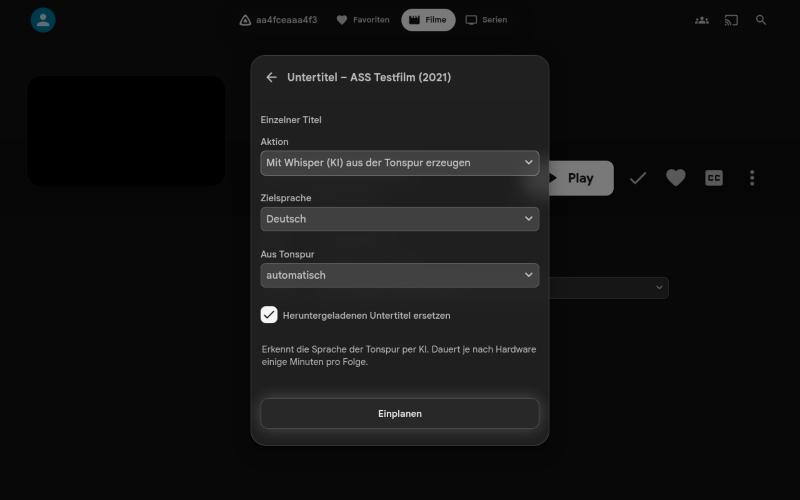
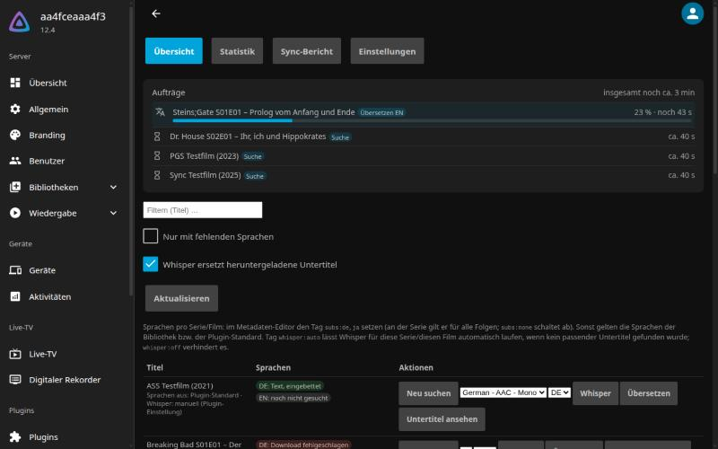
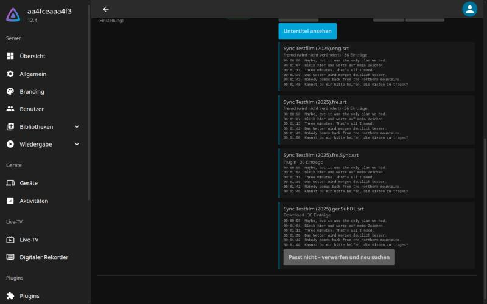
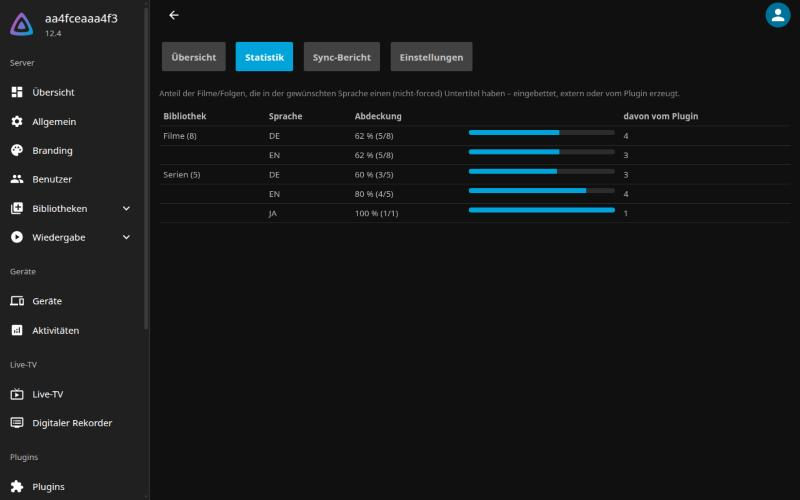
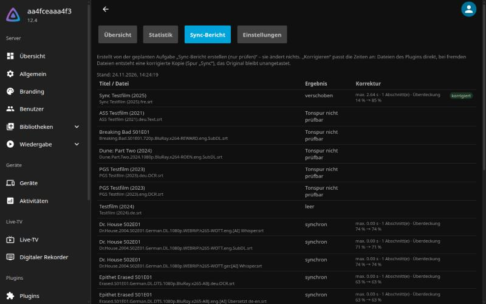
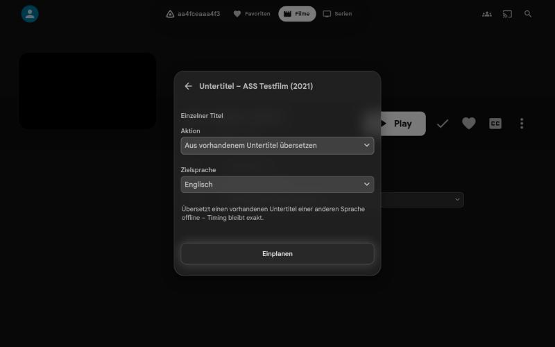

# SubtitleForge for Jellyfin

**Good subtitles for your whole library, without Bazarr, Sonarr or Radarr.**
SubtitleForge is a self-contained Jellyfin plugin. It converts Blu-ray image subtitles to text, downloads missing
subtitles and checks them against the audio, fixes subtitles that are out of sync, translates existing subtitles offline,
and as a last resort generates them from the audio with Whisper (CPU, or GPU via Vulkan). All subtitles get one
consistent style in the web client.

> [!WARNING]
> **This project was created with generative AI.** The code, the tests and this documentation were written in
> collaboration with an AI assistant (Anthropic Claude) and reviewed and tested on real libraries by a human. It works
> well for its author, but it has not been audited. Read the code before you trust it with your library, keep backups,
> and report problems. There is no warranty (see [License](#license)).

> [!NOTE]
> The user interface is available in **English and German**. It follows the server's display language, or set it
> under *Settings → Language of the plugin*. Translations into more languages are welcome.



## Contents

- [Features](#features)
- [Screenshots](#screenshots)
- [Requirements](#requirements)
- [Installation](#installation)
- [Getting started](#getting-started)
- [How it decides what to do](#how-it-decides-what-to-do)
- [GPU acceleration](#gpu-acceleration)
- [Privacy: what leaves your server](#privacy-what-leaves-your-server)
- [Security](#security)
- [Building and tests](#building-and-tests)
- [License](#license)

## Features

**Uniform look**
- One subtitle style for the whole server: font, size, colour, outline, background and position. The style is enforced
  in Jellyfin Web and Jellyfin Desktop, without changing any files.
- Every subtitle the plugin writes is clean SRT, without font or colour tags. That way the app settings on Android TV,
  Fire TV and phones apply evenly too.
- Optional: removes non-speech captions like `[SCREAMING]`, `(gunshots)` or `JOHN:`, and optionally song lyrics.
- Repairs broken umlauts and encoding mistakes (`ä` → `ä`). Optional: re-wraps long lines (max. 42 characters) and
  keeps very short subtitles on screen long enough to read.
- Optional: converts embedded ASS/SSA subtitles (anime typesetting) into clean SRT, so they follow the style.
- A **live preview** on the settings page shows the style on a player-like picture, on a dark and a bright scene.
- Every file the plugin writes carries the mark **`[SF]`** in its track name (e.g. `[SF] SubDL`, `[SF] OCR`,
  `[SF] [AI] Whisper`), so you always see which subtitles came from SubtitleForge.

**Getting subtitles**
- **OCR:** converts image subtitles to text: Blu-ray (PGS) and DVD (VobSub). Uses its own decoders and PaddleOCR
  (PP-OCRv5), runs fully offline, typically 98–99 % character confidence.
  A word list pass (English and German) fixes typical letter confusions like `rnorning` → `morning` or `Iassen` → `lassen`.
- **Downloads** from SubDL, OpenSubtitles.com and Jimaku (anime).
  - Candidates are ranked by release group, source, resolution and episode.
  - OpenSubtitles hash matches are preferred.
  - Daily limits are respected: the library is worked through over several nights.
- **Audio check:** every download is aligned to the speech in the audio track (Silero VAD).
  - Fixes offset, frame rate and cut differences.
  - A subtitle that belongs to a different cut is rejected instead of being saved.
- **Translation of existing subtitles**, offline: e.g. the official German track into English. You can pick which subtitle is translated, or let the plugin choose.
  - The timing stays exact, and there are no speech-recognition errors.
  - Pairs: German↔English, Japanese↔English, Japanese↔German via English.
- **Whisper:** generates subtitles from any audio track into any of the supported languages.
  - Runs on demand, or automatically as a last resort when nothing was found for X days.
  - Results are labelled `[SF] [AI] Whisper` / `[SF] [AI] Translated` (German UI: `Übersetzt`), so machine-made text is
    always recognisable.
- **Forced subtitles** (signs, songs, foreign-language parts) for dubbed versions: derived from ASS tracks or downloaded
  as "foreign parts only". Unflagged forced tracks are detected.

**Control**
- **SubtitleForge in Jellyfin's "⋮" menu** of every movie, episode, season and series (on cards, lists and the item
  page), plus a CC button on the item page, for administrators. From there you can search, translate, start Whisper
  or **delete single subtitles** the plugin made, also for a whole season or series at once.
- Works with Jellyfin's **multi-select**: select several titles, open the "⋮" menu, choose SubtitleForge.
- **In the player:** a button next to Jellyfin's subtitle button opens the subtitle that is playing right now. From
  there: *other match* (reject and search again), *check sync* against the audio, or shift the timing earlier/later
  (±0.25 s, ±1 s). The player reloads the subtitle right away. The same tools are in the file list of every title.
- **Recycle bin:** deleted or rejected subtitles stay restorable for 30 days (adjustable), per title or in the statistics.
- An **overview page** with its own entry in the dashboard sidebar. It shows:
  - per title, which languages exist, where they came from, and why something is missing
  - a preview of every subtitle file, with a *doesn't fit* button (the download is blocked and searched again)
  - a **job list** with progress, remaining time per job and in total
  - **batch actions:** tick titles (or "all with missing languages") and search, translate or run Whisper for all of them
  - a filter for titles that miss one specific language
  - **statistics:** coverage per library and language, and what the plugin learned about each source
  - a **sync report:** checks all external subtitles against the audio without changing anything, then fixes them on request. Files the plugin did not make get a corrected copy, the original stays untouched.
- Choose which **libraries** the plugin works on. Set languages per series or movie with a tag (`subs:de,en`).
- Respects viewers: heavy work **pauses while someone is watching** (a running Whisper job is suspended and resumed).
  Automatic work can be limited to a **time window**, e.g. 1–7 am.
- A **summary** after every run goes to Jellyfin's activity log. Optionally it is also sent via webhook (ntfy, Gotify,
  Discord or plain JSON). An optional **weekly report** sums up the week and lists titles still without a fitting subtitle.
- **Learns which sources fit:** downloads you keep raise a source a little in the ranking, rejected ones lower it.
- **Settings backup:** export and import all settings as a file, without API keys, passwords and webhook.
- **Crash-safe:** Whisper runs in a separate process.
  - If a GPU driver crashes, Jellyfin keeps running and the job is redone on the CPU.
  - A short GPU self-test after startup shows driver problems right away.
- **Never touches your files:** the plugin only deletes or overwrites files it created itself. A subtitle you delete is
  not created again automatically.

## Screenshots

| | |
|---|---|
|  |  |
| Overview with job list (progress, remaining time) | Preview of all subtitle files of a title |
|  |  |
| Coverage per library and language | Sync report: shifted subtitles, fixed on request |
|  |  |
| Translate an existing subtitle (item page) | Whisper from a chosen audio track (item page) |

The item page dialog is built from Jellyfin's own dialog components, so it follows the active theme. Shown here: the
default dark theme and [Abyss](https://github.com/AumGupta/abyss-jellyfin).

## Requirements

- **Jellyfin 12.x** (12.0 or newer, .NET 10), on Linux **x64 or arm64**.
- About 0.2–1 GB of free space for AI models. They are only downloaded when a feature first needs them.
- Optional: free API keys for [SubDL](https://subdl.com), [OpenSubtitles.com](https://www.opensubtitles.com) (plus
  account) and [Jimaku](https://jimaku.cc).
- Optional: a GPU for Whisper (AMD, Intel, or NVIDIA with the proprietary driver), see [GPU acceleration](#gpu-acceleration).

Runs fine on small hardware: OCR, sync and translation are CPU-friendly. Whisper on a 4-core CPU takes roughly
5–10 minutes per episode with the `small` model.

## Installation

### From the plugin repository (recommended)

1. Jellyfin → **Dashboard → Plugins → Repositories → +**. Enter any name and this URL:
   ```
   https://raw.githubusercontent.com/dotnomi/jellyfin-plugin-subtitleforge/main/manifest.json
   ```
2. **Catalog** → *SubtitleForge* → install.
3. Restart Jellyfin.

### Manually

1. Download `subtitleforge_<version>.zip` from the [Releases](../../releases).
2. Extract it to `<jellyfin data>/plugins/SubtitleForge_<version>/`. On Debian/Ubuntu that is `/var/lib/jellyfin/plugins/`.
3. Make the folder owned by the Jellyfin user and restart Jellyfin.

## Getting started

1. Open **Dashboard → SubtitleForge → Settings**.
2. **Libraries:** tick the libraries the plugin should work on. Start with a small one.
3. **Languages:** default languages, e.g. `de,en`. Per series or movie you can override them with the tag
   `subs:de,ja` in the metadata editor; `subs:none` disables a title.
4. Enter the **API keys** of the download sources you want to use.
5. Optional: choose the subtitle **style**, enable **GPU** for Whisper, set the **time window** or a **webhook**.
6. Start the scheduled tasks once by hand (**Dashboard → Scheduled Tasks → SubtitleForge**). After that they run every night:

| Task | Default schedule |
|---|---|
| Convert image subtitles to text (OCR) | daily 03:00 |
| Download missing subtitles (download, translate, Whisper last resort) | daily 04:00 |
| Check and fix subtitle sync | manual |
| Create sync report (check only) | manual |

New movies and episodes are processed automatically a few minutes after the library scan, if enabled.

**Tags**

| Tag | Effect |
|---|---|
| `subs:de,en` | Languages for this series/movie (on a series: all episodes) |
| `subs:none` | Do nothing for this title |
| `whisper:auto` | Generate with Whisper right away when no subtitle was found |
| `whisper:off` | Never use Whisper automatically for this title |

## How it decides what to do

For each wanted language without a subtitle, the plugin goes through these steps in order and stops at the first that works:

1. **Embedded text subtitle** in the file: nothing to do.
2. **Embedded image subtitle** (PGS): convert with OCR.
3. **Download** from SubDL / OpenSubtitles / Jimaku, verified against the audio and corrected if needed.
4. **Translate** an existing subtitle of another language (preferably the official one).
5. **Whisper**: only on demand, with the `whisper:auto` tag, or as the configured last resort after X days.

## GPU acceleration

Whisper uses the GPU via Vulkan when one is usable, and falls back to the CPU otherwise.

**Native installation** (Debian/Ubuntu):
```bash
sudo apt install libvulkan1 mesa-vulkan-drivers
```
The `jellyfin` user needs access to `/dev/dri`, just like for hardware transcoding.

**NVIDIA:** only with the proprietary driver. The open-source Mesa driver for NVIDIA hangs on these workloads and is
skipped automatically.

**Docker:** the official image contains no Vulkan. [`docker/`](docker/) has a small `Dockerfile` that adds it and a
`compose.yaml` that passes the GPU through:

```bash
cd docker
docker compose up -d --build
```

- AMD/Intel: `/dev/dri` is passed through and the container joins the host's `render` group
  (`getent group render | cut -d: -f3`, set it as `RENDER_GID`).
- NVIDIA: install the NVIDIA Container Toolkit on the host and use the commented NVIDIA block. The driver capability
  `graphics` is required, otherwise the container gets no Vulkan driver.
- linuxserver.io image: same idea, add `libvulkan1 mesa-vulkan-drivers` in your own image based on it.

**Intel Arc on Proxmox:** with Proxmox' 6.8 kernel, the `i915` driver hung on Whisper compute jobs (GPU hang). With the
opt-in kernel **6.14** it runs stably. The plugin survives such hangs either way and finishes on the CPU.

The settings page shows which GPU was found and whether Whisper runs on it. It also has a *test GPU now* button.

## Privacy: what leaves your server

- **Download sources** (SubDL, OpenSubtitles, Jimaku) receive what is needed to find subtitles: title, year, IMDb/TMDb
  id, season/episode, and for OpenSubtitles the file hash. They also receive your API key and, for OpenSubtitles, your login.
- **Model downloads** come from Hugging Face, from pinned versions with checksums: Whisper models and translation models.
- **Optional webhook:** the run summary with titles and file names.

Nothing else. OCR, sync, translation and Whisper run locally.

## Security

The plugin runs inside your Jellyfin server, so it is built to keep that door closed:

- All plugin API endpoints require an **administrator**. The only anonymous endpoint is the style script that every
  client loads; it contains the style settings and nothing else.
- **Downloads** only go over https to the known hosts of each source (SubDL, OpenSubtitles, Jimaku), with size limits.
  API keys are only ever sent to their own service. Search results handed to Jellyfin are signed, so a client cannot
  make the server fetch other URLs.
- **Untrusted files** (downloaded archives, subtitle tracks inside media files) are parsed with hard limits: no zip
  bombs, bounded memory for image subtitles, safe file names even for odd language tags.
- **Files:** the plugin only writes, renames or deletes subtitle files it made itself, recognised by their name
  (`[SF]` mark or one of its tags). Writes are atomic and never follow planted links.
- ffmpeg only reads local files (`-protocol_whitelist file`); all processes are started without a shell.

Known limits: whether a file belongs to the plugin is decided by its name, so a file of your own that you name like a
SubtitleForge file (e.g. with `[SF]`) is treated as the plugin's. Users who may edit metadata can set the `subs:` and
`whisper:` tags and so cause work on the server.

Found a vulnerability? Please report it privately, see [SECURITY.md](SECURITY.md).

## Building and tests

Requires the .NET 10 SDK.

```bash
dotnet test Jellyfin.Plugin.SubtitleForge.Tests
./tools/package.sh 0.3.0.0
```

`package.sh` builds the release zip, `dist/subtitleforge_<version>.zip`.

**Without a local SDK:** `dev-deploy.sh` builds in a Podman container and deploys into a local test Jellyfin.

**Releases:** pushing a tag `v<version>` makes GitHub Actions build the zip, create a release and add the version to
`manifest.json`.

**Optional tests with real media**, enabled through environment variables (see the test files):
- `SF_REAL_DIR`, `SF_ANIME_DIR`: sync calibration
- `SF_WHISPER_DIR`: Whisper
- `SF_MT_DIR`: translation
- `SF_JADE_DIR`: Japanese→German comparison

## License

[MIT](LICENSE): you can do whatever you want with this, as long as the license notice stays.

- The plugin runs inside Jellyfin (GPL-2.0) and uses its API.
- Bundled and downloaded third-party components keep their own licenses, see
  [THIRD-PARTY-NOTICES.md](THIRD-PARTY-NOTICES.md). They are Apache-2.0, MIT, CC-BY-SA-4.0 (FuguMT models, downloaded at
  runtime) and GPL-3.0 with the GCC runtime exception (libgomp).
- Subtitles from download sources are subject to those sources' terms.
